<p align="center">
  
</p>

<h1 align="center">oh-my-x</h1>

<p align="center">
  <strong>给 X（Twitter）网页端补上常用但缺失的功能。</strong><br>
  页面布局、垃圾回复过滤、数据标注、创作辅助、快捷互动，每一项都能单独开关。
</p>

<p align="center">
  <a href="https://github.com/longhaiqwe/oh-my-x/releases/latest"><strong>下载最新版</strong></a> ·
  <a href="#安装">安装</a> ·
  <a href="#功能详解">功能详解</a> ·
  <a href="PRIVACY.md">隐私政策</a> ·
  <a href="README.en.md">English</a>
</p>

<p align="center">
  
</p>

<p align="center">
  <sub>中文 / English 界面 · Chrome / Edge（Manifest V3） · 设置和数据只存在本机 · AI 功能可选，使用你自己配置的服务</sub>
</p>

---

## 为什么做这个

X 网页端有不少操作要绕路，比如：

- 长文和帖子下面混着大量塞满 emoji 的引流号、色情引流号回复；
- 在几千字的长文下面回复，要往下滚好几屏才到输入框；
- 想在新帖里引用自己以前的帖子或长文，要另开一个标签页去找链接；
- 在自己的「正在关注」列表里看不出谁没回关，只能一个个点进主页确认。

oh-my-x 在星川（[@star_flow_ai](https://x.com/star_flow_ai)）的 [X Focus](https://x.com/star_flow_ai/status/2097583620936585339) 基础上开发，加入了作者自己和 X 上朋友们提出的需求。用不上的功能都可以在设置里关掉。

## 功能一览

<p align="center">
  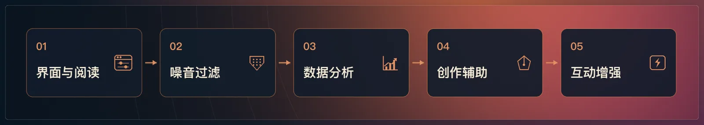
</p>

设置弹窗按五个模块分标签，下表和后文的名称与弹窗一致：

| 模块 | 功能 |
|------|------|
| [01 界面与阅读](#01-界面与阅读) | 时间线宽度、隐藏右侧边栏和发帖按钮、导航栏按钮与文字、长文目录、搜索默认「最新」、搜索筛选条、问 Grok、AI 转搜索语法 |
| [02 内容过滤](#02-内容过滤) | 垃圾回复过滤（9 条规则 + 垃圾词库）、账号例外、拦截记录、正文关键词过滤 |
| [03 数据洞察](#03-数据洞察) | 原创内容奖励计划、博主活动度、爆款雷达、数据比例徽章、用户粉丝数、收藏量 |
| [04 创作与发布](#04-创作与发布) | 引用我的帖子、多图排版与排序、按名字艾特、右键存草稿、AI 总结转发、排期全景 |
| [05 互动与列表](#05-互动与列表) | 快捷键与底部悬浮条、直达回复区、回复自动点赞、媒体下载、未互关标记、X Lists |

---

## 安装

### 方式一：下载发行包（推荐，不需要开发环境）

1. 在 [Releases 页面](https://github.com/longhaiqwe/oh-my-x/releases/latest) 下载 `oh-my-x-chrome-mv3.zip`
2. 解压，得到 `chrome-mv3` 文件夹。把它放在一个固定位置，以后不要挪动
3. 打开 `chrome://extensions`（Edge 同样适用），开启右上角的「开发者模式」
4. 点「加载已解压的扩展程序」，选择 `chrome-mv3` 文件夹

**升级**：解压新版本，用里面的文件覆盖原来的 `chrome-mv3` 文件夹，再到 `chrome://extensions` 点 oh-my-x 卡片上的刷新按钮。

> [!WARNING]
> 换文件夹位置，或点「移除」后重新加载，Chrome 会当成一个新扩展，设置、词库和拦截记录都会清空。

### 方式二：从源码构建

需要 Node.js 24（自带 npm）。

```bash
git clone https://github.com/longhaiqwe/oh-my-x.git
cd oh-my-x
npm install
npm run build
```

然后在 `chrome://extensions` 开启「开发者模式」，点「加载已解压的扩展程序」，选择 `oh-my-x/build/chrome-mv3/`。

### 方式三：Chrome 网上应用店

> 审核中，通过后补上安装链接。

---

## 功能详解

### 01 界面与阅读

<p align="center">
  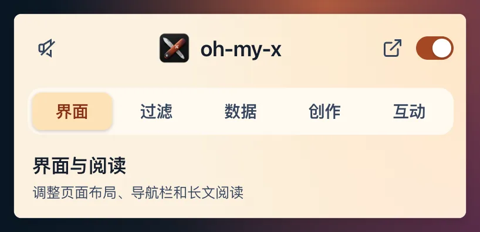
</p>

#### 时间线宽度

在 600 到 800 像素之间调整主时间线的宽度，也就是下图箭头标出的那一段。

<p align="center">
  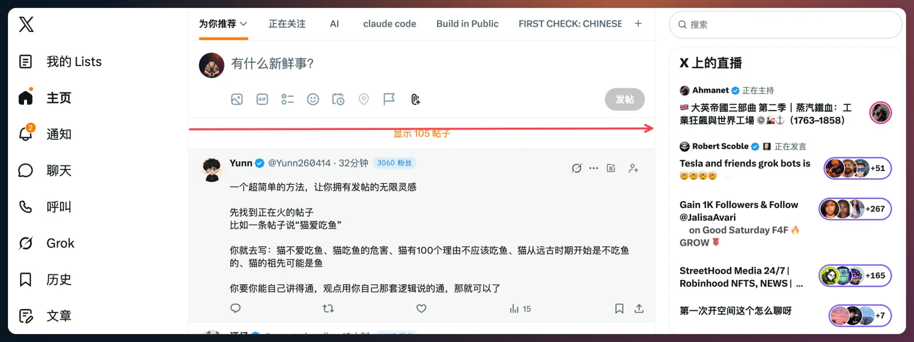
</p>

#### 隐藏右侧边栏、隐藏发帖按钮

两个开关，打开即隐藏。右侧边栏包括搜索、推荐关注和趋势；发帖按钮隐藏后可以按 `N` 发帖，搜索可以从左侧「探索」进入。屏幕较小时隐藏这两块，时间线能占更多空间。

<p align="center">
  
</p>

#### 导航栏按钮与文字

探索、通知、聊天、Grok、Premium、历史、文章、个人资料、更多、X Money 共 10 个按钮可以分别隐藏。被 X 收进「更多」菜单的入口，也会在菜单里一起隐藏。导航文字可设为从不、悬停或始终显示。

<p align="center">
  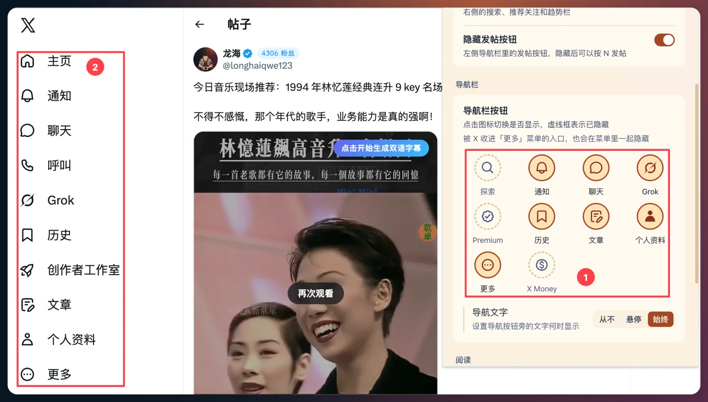<br>
  <sub>设置里的按钮（❶）和页面左侧导航栏（❷）一一对应</sub>
</p>

#### 长文目录

在长推文、长文阅读页和长文编辑器侧边，提取一级和二级标题生成目录，点击跳到对应位置。能识别 Markdown 标题（`#`、`##`）、「一、」「第一章」这类中文序号、「1.」「(1)」这类数字序号，以及整段加粗的段落。

<p align="center">
  
</p>

#### 搜索默认「最新」

X 的搜索默认打开「热门」，按互动量排列，会混进几个月前的帖子。打开这个开关后，新的搜索（换了搜索词，或从别的页面进来）打开「最新」标签，按发布时间排列。话题标签页同样处理。在同一个搜索里点回「热门」，这个搜索词之后保持「热门」。

#### 搜索筛选条

搜索结果页和话题标签页的标签下面多一排筛选，不用记搜索语法：

| 筛选 | 选项 | 写进搜索词的语法 |
|------|------|------|
| 时间 | 24 小时内 / 7 天内 / 30 天内 | `within_time:24h` / `7d` / `30d` |
| 点赞数 | 至少 10 / 100 / 1000 赞 | `min_faves:10` 等 |
| 图片视频 | 带图片 / 带视频 / 带图片或视频 | `filter:images` / `filter:videos` / `filter:media` |
| 只看原帖 | 开 / 关 | `-filter:replies` |
| 只看关注的人 | 开 / 关 | 地址参数 `pf=on` |

选择后改写搜索词重新搜索，搜索框里能看到并继续修改。搜索框里自己写的同类语法（如 `min_faves:500`）会显示在对应的下拉框里。「用户」「列表」标签不显示筛选条。

没有语言筛选：X 把长文帖的语言记为「无文字」，用 `lang:zh` 会把中文长文一起排除。需要时可以在搜索框里自己加 `lang:zh`，筛选条会原样保留。

#### 问 Grok

在搜索框里输入文字后，下拉列表里「搜索“…”」下面多一项「问 Grok」。点一下打开 Grok 页面并填好这段文字，X 会弹出确认框，点 Send 后 Grok 才收到问题。

从属开关「回车问 Grok」（默认关闭）：打开后在搜索框按回车直接打开 Grok，不做普通搜索。要普通搜索时点下拉里的「搜索“…”」；用方向键选中下拉里的项目后按回车，仍按 X 原来的方式。

#### AI 转搜索语法

下拉列表里还有一项「用 AI 转成搜索语法」：用你在「设置 → AI 服务」配置的模型，把大白话转成 X 的搜索语法，再用 X 自己的搜索去搜。提示词里给模型的示例：今天是 2026-10-23 时，「上周关于 Claude、点赞过千的中文帖」转成 `Claude lang:zh min_faves:1000 since:2026-10-16`；实际结果取决于你用的模型。结果是 X 原生的帖子列表，可以切「最新」、点赞、回复。

需要先配置 AI 服务；没配置或没授权时，这一项下面显示报错和「打开 AI 服务设置」。点这一项时，搜索框里的文字会发给你配置的 AI 服务。

### 02 内容过滤

<p align="center">
  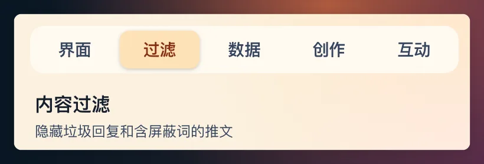
</p>

#### 垃圾回复过滤

按规则给推文详情页里的回复打分，得分达到隐藏阈值（默认 55，可在 20 到 150 之间调整）的回复会被隐藏。只处理推文详情页的对话，首页等时间线不处理。

**9 条检测规则**，可逐条开关：

| 规则 | 检测内容 | 默认分 |
|------|---------|--------|
| 营销昵称 | 昵称含「点击主页 / 同城 / 约会 / 固炮」等词 | +40 |
| Emoji 占比 | 回复中 emoji 超过文字的一半 | +20 |
| 评论过短 | 正文少于 8 个字符；英文等按词算，少于 2 个词 | +10 |
| 随机用户名 | 用户名像随机的字母加数字组合（特征明显时最高 +25） | +10 |
| 垃圾词库 | 回复命中词库中的词（多词累加，最高 65） | +35 |
| 纯 Emoji 评论 | 去掉 emoji 后内容为空 | +40 |
| 装饰昵称 | 昵称含 2 个以上 emoji | +15 |
| 重复字符 | 同一字符连续重复 4 次以上（如「哈哈哈哈」） | +20 |
| 矩阵引流 | 用「看@」「主页@」「👉@」「visit @」等引导到其他账号，或结尾 @ 账号后跟几个随机字符或表情 | +20 |

- **垃圾词库**：第一个命中的词 +35，每多命中 1 个不同的词再加 15，最高 65。和正文屏蔽词分开管理。新安装时按界面语言写入默认词：中文界面写中文词库，英文界面写英文词库（如 "check my bio"、"dm me"）；「补充默认词」「恢复默认」也按当前界面语言。
- **选词**：推文右上角「更多」按钮旁的选词按钮，可以从昵称和回复内容里点选词语加入词库。
- **调试模式**：在每条回复下显示得分和命中的规则，用来调整阈值和词库。

<p align="center">
  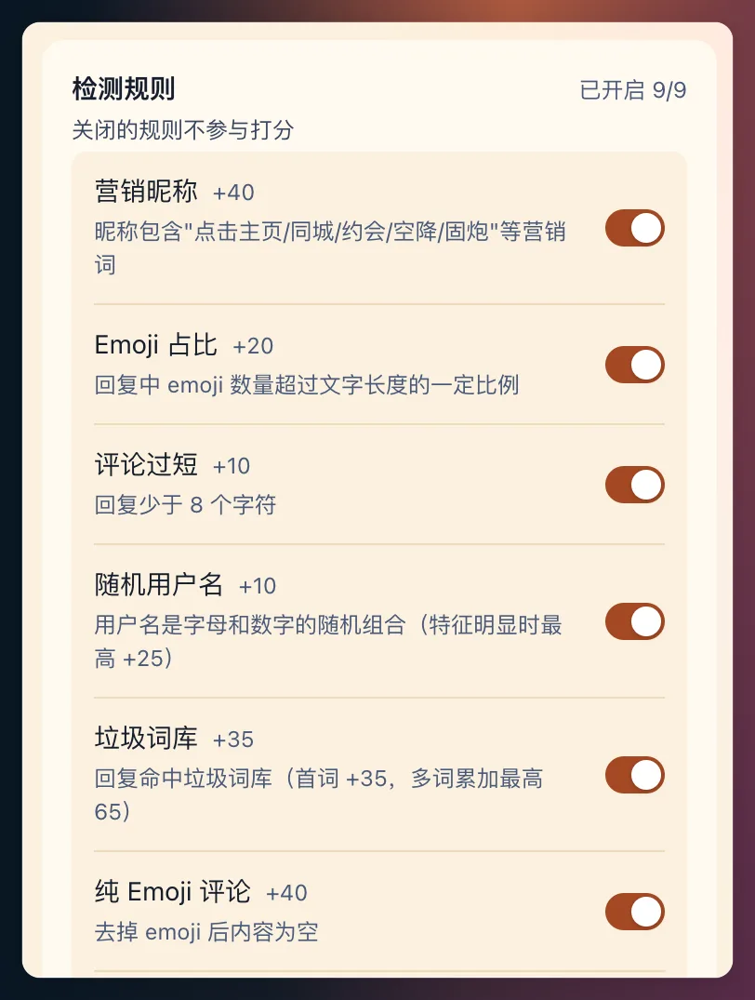
  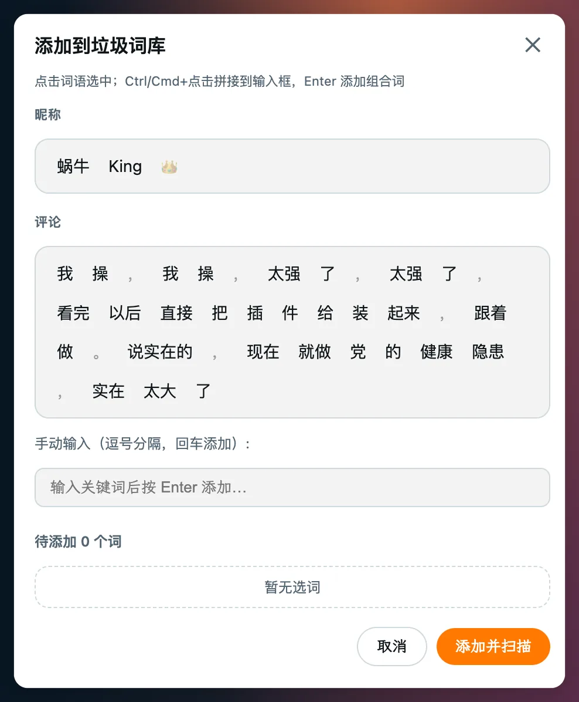<br>
  <sub>左：检测规则；右：从回复里选词加入垃圾词库</sub>
</p>

#### 账号例外

按 `@handle` 设置白名单和黑名单：白名单作者的回复不隐藏，黑名单作者的回复全部隐藏。推文右上角「更多」按钮旁的名单按钮可以直接把作者加入名单。

<p align="center">
  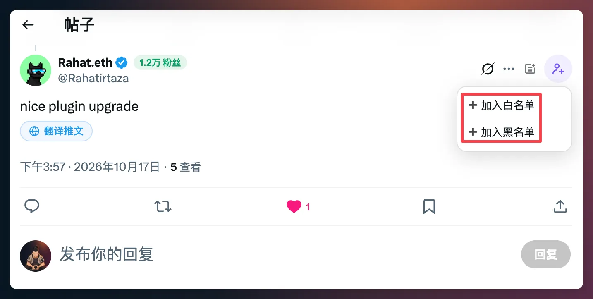
</p>

#### 拦截记录

本机保存最近 50 条被隐藏的回复，记下命中的规则和得分，并按分类统计每天的数量。「过滤」页显示今日拦截总数和最近几条记录，点「全部记录」查看详情。

<p align="center">
  
</p>

#### AI 判断进度

评论 AI 判断支持流式显示：模型每返回一条完整评分，就立即更新对应回复，无需等待整批完成。顶部显示「AI 判断中 · 3/20」和加载动画，数字表示本页已完成数 / 当前已完成与等待结果的总数；新回复进入判断队列时总数会变化。

已经完成的结果会逐条缓存。若后续超时或连接中断，已有结果保留，重试只处理尚未完成的回复。批量大小仍为最多 20 条，模型可以比较同批回复。首段数据需在 25 秒内返回，之后连续 15 秒没有新数据或总耗时达到 90 秒才会中止。服务需要支持 OpenAI 兼容的流式响应；若服务忽略流式参数、返回普通 JSON，仍按整批结果显示。

#### AI 判断出错时

开启评论 AI 判断后，帖子页标题栏会区分请求超时、输入内容过长、接口限流、鉴权失败、网络异常和扩展连接失效。点击错误提示可查看原因、处理建议和原始错误详情，并选择重试、打开 AI 设置或刷新页面。

`Extension context invalidated` 表示扩展与旧页面的连接失效，常见于扩展更新或重新加载之后。刷新当前 X 页面可重新建立连接；它不是 AI 上下文过长的提示。AI 请求按首段等待、数据中断和总耗时分别计时，只有服务明确报告上下文超限时，才提示输入内容过长。

#### 正文关键词过滤

信息流中正文含屏蔽词的推文，可以折叠成一行提示（点击展开，可再收起），也可以直接隐藏。英文界面新安装时，默认屏蔽词是 "hot take"、"unpopular opinion" 等英文词。

<p align="center">
  
</p>

### 03 数据洞察

<p align="center">
  
</p>

#### 原创内容奖励计划

在弹窗里显示创作者奖励计划的曝光进度（过去 90 天累计的已验证首页时间线曝光 / 50 万）。

下方显示某一天的曝光转化：整体曝光、蓝 V 曝光（来自 X 账号分析）、计入奖励的曝光，以及蓝 V 占整体、计入奖励占蓝 V 的比例；再下面是近 7 天计入奖励的柱状图，点柱子切换日期。奖励计划只给累计数，插件每天北京时间 10:30 后记一次，计入奖励 = 当天累计减前一天累计，所以从记录的第二天起才有。日期按 UTC。

<p align="center">
  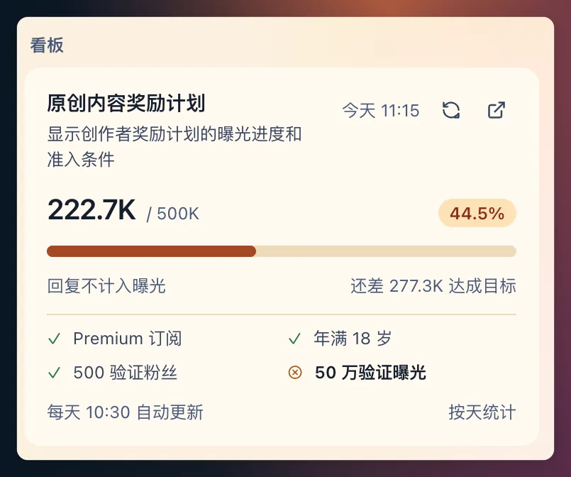
</p>

#### 博主活动度

在博主主页点「扫描近 7 天」，统计这位博主近 7 天每天的帖子数和回复数，可以看出对方主要在发帖，还是常在评论区互动。X 接口有调用频率限制，短时间扫描太多次会提示稍后再试。

<p align="center">
  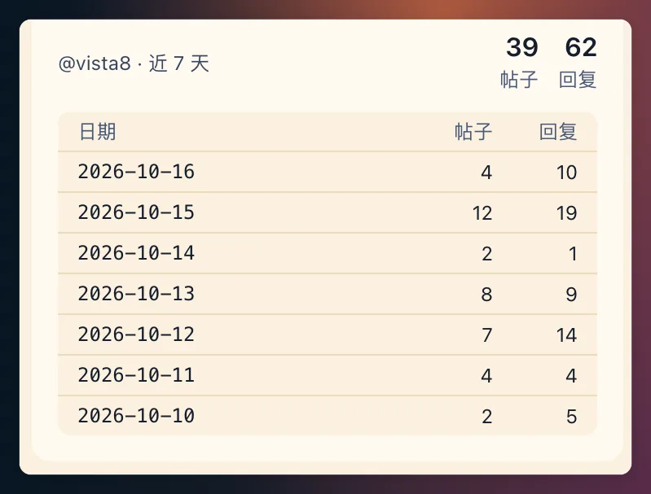
</p>

#### 爆款雷达

按每小时浏览量（浏览量 ÷ 发布时长）把推文分为普通、潜力和爆款（默认分界线为每小时 1000 和 10000 次浏览），在信息流中加标签，可选边框、背景或两者一起高亮。

<p align="center">
  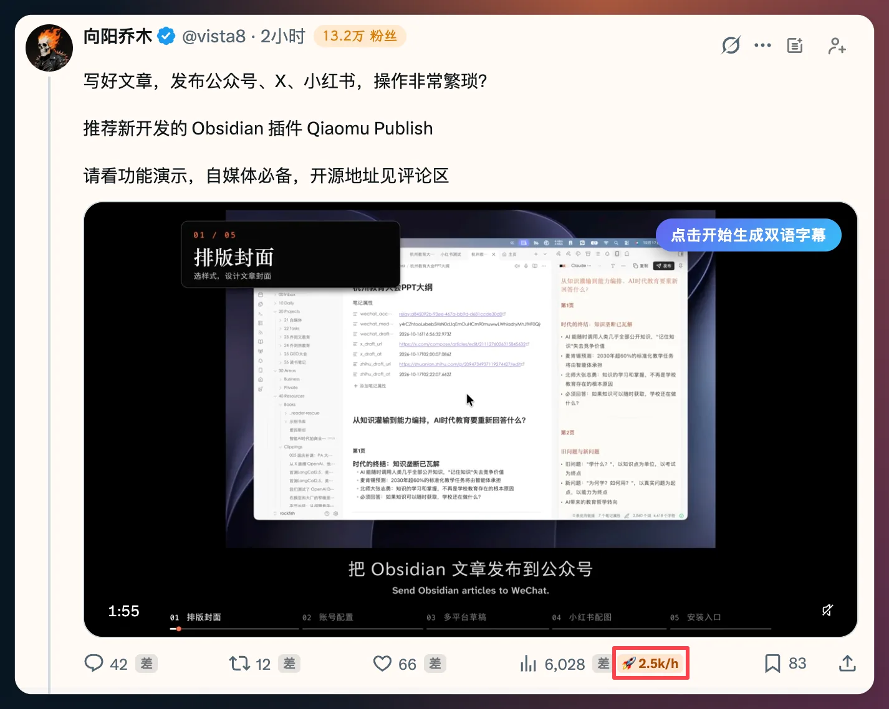
</p>

#### 数据比例徽章

在博主主页的推文下，给浏览、回复、转帖、喜欢各加一个徽章，显示这个数和作者粉丝数的比值，并按评级标准分为差、普通、良好、优秀、爆火五档。

<p align="center">
  
</p>

#### 用户粉丝数

在推文作者旁和关注、粉丝、搜索等用户列表中显示粉丝数（如「12.5万 粉丝」），悬停查看精确的粉丝数和关注数。可选「全部」（默认，推文作者和用户列表都显示）、「仅列表」或「关闭」。

<p align="center">
  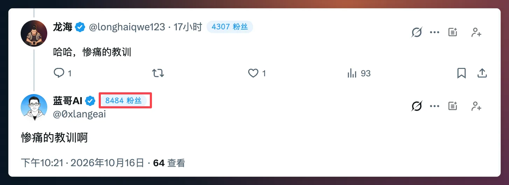
</p>

#### 收藏量

在推文的书签按钮旁显示收藏数。可以在「数据 → 页面标注」关闭，关闭后已显示的数字会立即移除。

<p align="center">
  
</p>

### 04 创作与发布

<p align="center">
  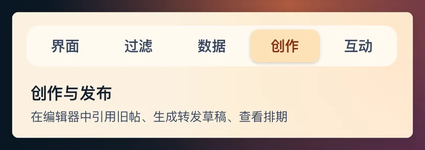
</p>

#### 引用我的帖子

在发帖、引用和回复编辑器里多一个按钮，搜索自己发过的帖子和长文，点击结果把链接插入草稿，不用另开标签页去找。

- 帖子正文、长文标题、日期和链接按账号分开，存在扩展本地的 IndexedDB（浏览器内置的数据库）里。
- 打开已登录的 X 后自动分批同步历史帖子（每批最多 20 页、每页间隔 2.5 秒，断点会保存，关掉页面下次打开接着同步），之后约每 30 分钟检查一次新帖。多个标签页共用一把同步锁，可以暂停和继续。
- 可以在「创作 → 引用我的帖子」关闭「打开 X 时自动同步」，关闭后已有缓存仍可搜索，也可以手动同步。
- 受 X 接口返回范围限制，不保证能拿到全部历史；本地副本可能保留已删除或修改前的内容。不会自动发帖。

<p align="center">
  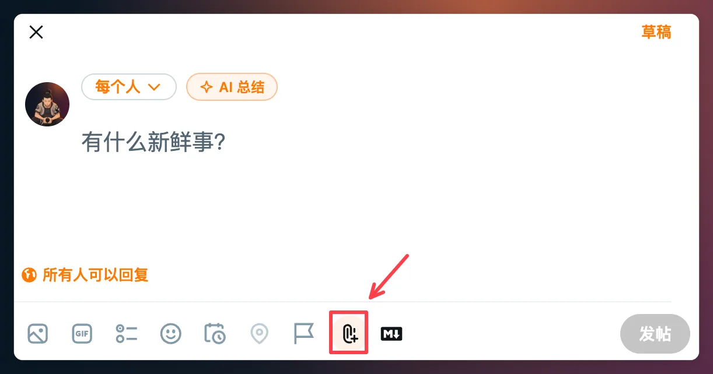
</p>
<p align="center">
  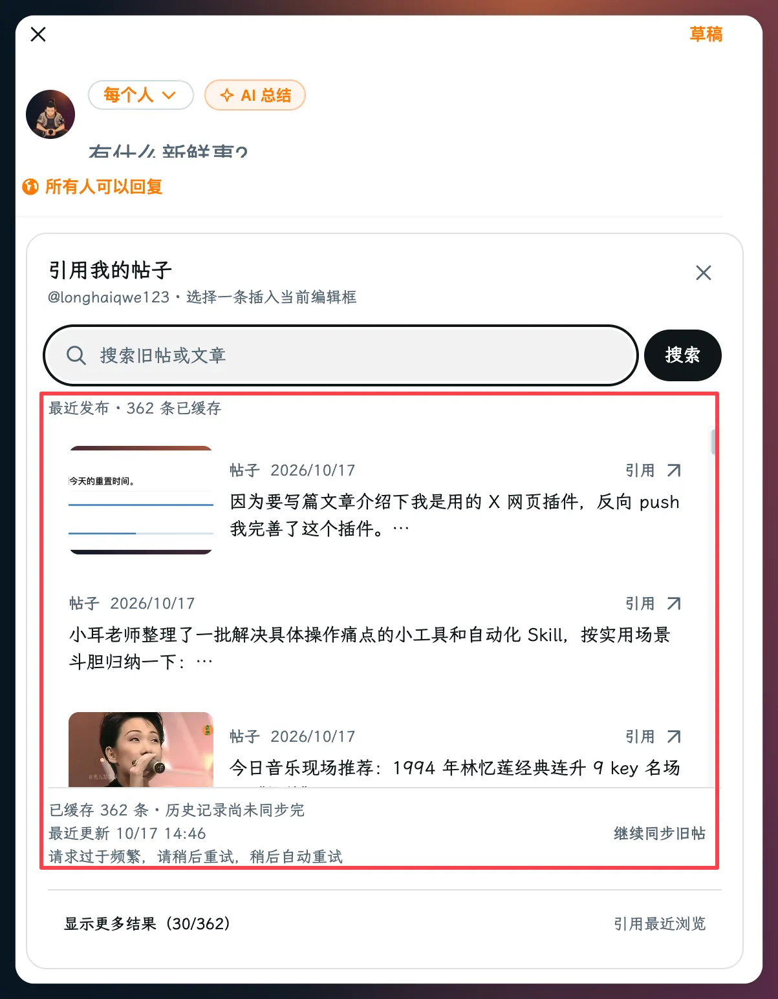
</p>

#### 多图排版与排序

发帖时放 2 到 4 张图，图片排成两列等大的格子，按发帖顺序从左到右、从上到下排，右下角标出序号，横图、竖图都完整显示。按住一张图拖到别的格子，松手后顺序就改好了，发出去的帖子、定时帖和草稿都按新顺序，不用删掉重传。

- 只是点一下图片时，照常打开 X 的「编辑媒体」；拖动时按 Esc 可以取消。
- 改的是 X 发帖框自己记录的图片顺序，不拦截、不修改发帖请求。读不到 X 的数据时保持 X 原来的排版，拖动失败会提示。
- 有视频或 GIF 时保持 X 原样。不需要时在「创作 → 多图排版与排序」关掉。

#### 按名字艾特

X 的发帖框只认 @ 后面的英文字母、数字和下划线，在 @ 后面输入中文名不会列出账号。打开这个功能后，在发帖、引用和回复编辑器里，@ 后面输入中文、日文等非英文名字，光标下方会列出名字相符的账号，已关注的排在前面。用上下键或鼠标选一个，按回车、Tab 或点击，「@名字」换成「@用户名 」，X 按艾特处理。

- 查询用的是 X 发帖框自己的用户查询接口，输入的名字会发给 X。英文名 X 自己会列出候选，这个功能不处理。
- 只按对方在 X 上显示的名字查。简体和繁体分开查，对方名字写的是繁体时，用简体搜不到；对方名字是英文时，搜中文译名找不到。
- 用拼音等输入法时，选完字才查询。按 Esc 只关闭列表，发帖弹窗保留。不需要时在「创作 → 按名字艾特」关掉。

#### 右键存草稿

在任意网页选中一段文字，右键点「存为 X 草稿」，选中的文字存进 X 草稿箱，后面空一行附上这个网页的链接。存好后扩展图标上显示 ✓，3 秒后去掉。之后在 X 发帖框右上角的「草稿」里找到它。

- 用这个浏览器里已登录的 X 账号，调用 X 网页存草稿时用的接口，不需要打开 X 标签页。
- 存不进去时（没登录 X、接口变了等），在当前标签页旁边打开 X 发帖页，文字已填好；关掉发帖框时点「保存」，存进草稿箱。
- 只附 http 和 https 网页的链接；选中的文字里已经有这个链接时不再附。
- 只在点菜单项时读一次当前网页里选中的文字。不需要时在「创作 → 右键存草稿」关掉，菜单项随之去掉。

#### AI 总结转发

在发帖、引用和回复编辑器里，点「AI 总结」按钮，读取原帖全文，用你配置的模型生成两条草稿。按钮位于「每个人」右侧；回复弹窗和页内回复框没有受众按钮时，入口放在输入框上方。页内回复以当前详情页的帖子为原文。选一条填进编辑器，再自己修改。草稿按插件界面语言写：中文界面写中文，英文界面写英文。

- 支持 OpenAI 兼容接口。在「设置 → AI 服务」填写接口地址、API Key 和默认模型，点「授权并测试连接」。扩展只申请这个服务地址的访问权限，拒绝授权就不会发请求。总结转发和评论判断共用此服务，各自可以单独填写模型，留空则跟随默认模型；旧版连接配置会自动迁移。
- 转发风格可以自己设：「风格描述」写一段想要的风格，「参考样本」贴 2 到 5 条自己写过的转发，每条之间用单独一行 `---` 隔开。两项都不填时用默认的平实风格。
- 生成时会把原文、作者信息、文章标题、转发风格和补充要求发给你配置的服务，连接测试只发送测试文本。请求首段数据等待上限为 25 秒，后续无数据上限为 15 秒，总耗时上限为 90 秒；点取消或关闭面板会中止请求，但服务商可能已经处理并计费。远程服务必须用 HTTPS；HTTP 只能用于本机的 localhost 和 127.0.0.1（如本地反代、Ollama）。

<p align="center">
  
  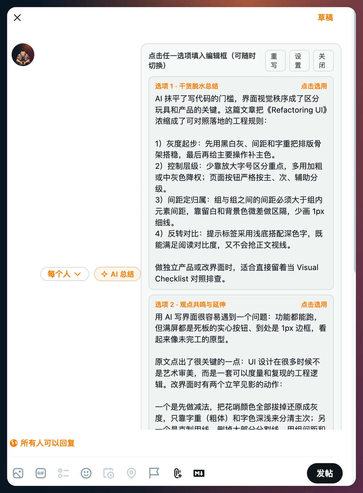<br>
  <sub>左：引用编辑器里的「AI 总结」按钮；右：生成的两条转发草稿</sub>
</p>
<p align="center">
  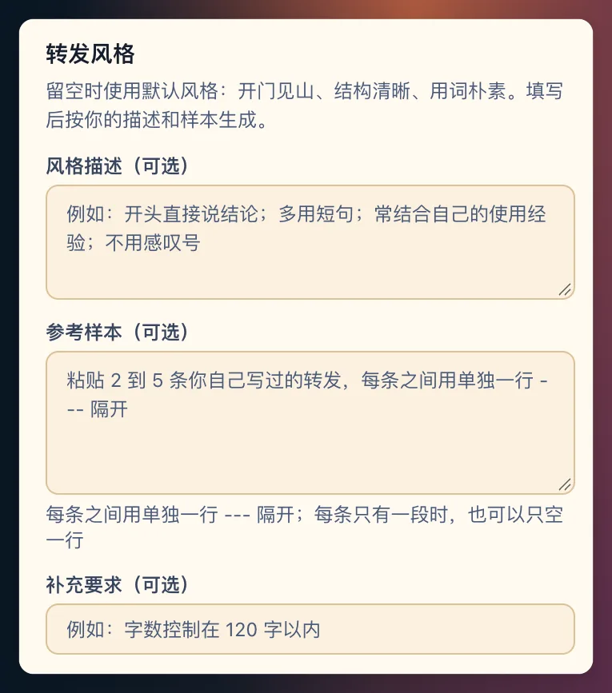
</p>

#### 排期全景

在定时发布弹窗和草稿箱里，列出所有定时帖的发布时间、距离现在多久，以及相邻两条之间的间隔。间隔按小于 2 小时、2 到 8 小时、8 到 24 小时、24 小时以上分色显示，小于 2 小时时提示间隔过密。

<p align="center">
  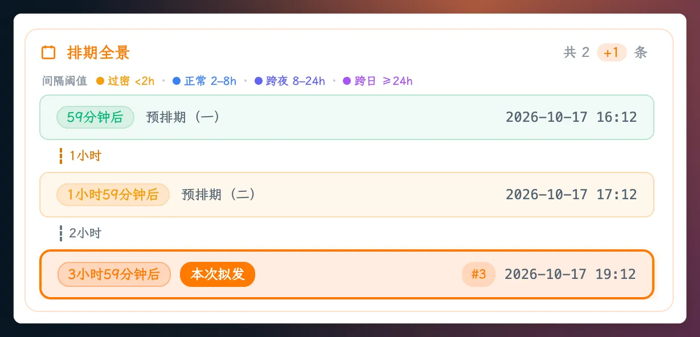<br>
  <sub>定时发布弹窗</sub>
</p>
<p align="center">
  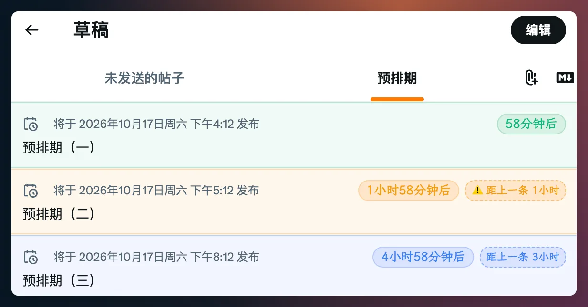<br>
  <sub>草稿箱</sub>
</p>

右侧栏搜索框下面还有一个排期面板：按天列出待发布的定时帖，每条显示发布时间和正文开头，相邻两条之间标出间隔，跨天的间隔写在日期那一行。点刷新按钮会直接向 X 重新读取排期，不用打开草稿箱；新建、修改、删除定时帖后也会自动重新读取。面板可以收起，不需要时在设置弹窗「创作 → 排期全景 → 右侧栏面板」里关掉。

### 05 互动与列表

<p align="center">
  
</p>

#### 快捷键与底部悬浮条

在推文详情页按数字键操作：`1` 回复、`2` 引用、`3` 点赞、`4` 收藏。页面底部还会显示这四个操作的按钮条，可以单独关闭。

<p align="center">
  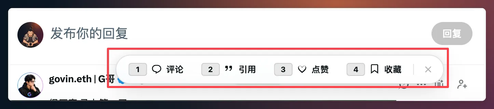
</p>

#### 直达回复区

在长文和长推文页右下角显示一个按钮，点击跳到评论区和回复框；到达评论区后按钮变成「回到正文」，再点一次回到正文。按钮挡住内容时，可以按住拖到别的位置，松开后位置会记住。

<p align="center">
  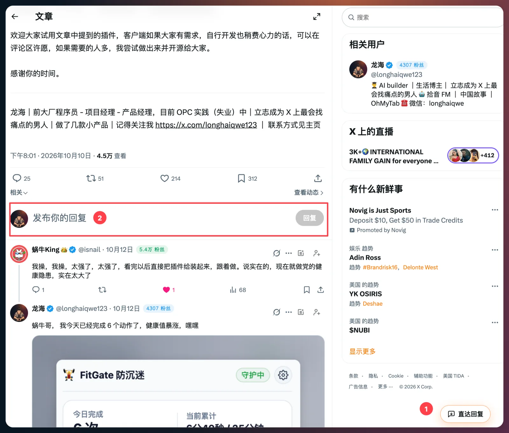
</p>

#### 回复自动点赞

回复别人的推文后，给这条推文点赞。点赞前随机等待 0.3 到 0.7 秒；已赞过的推文和自己的推文不点。

<p align="center">
  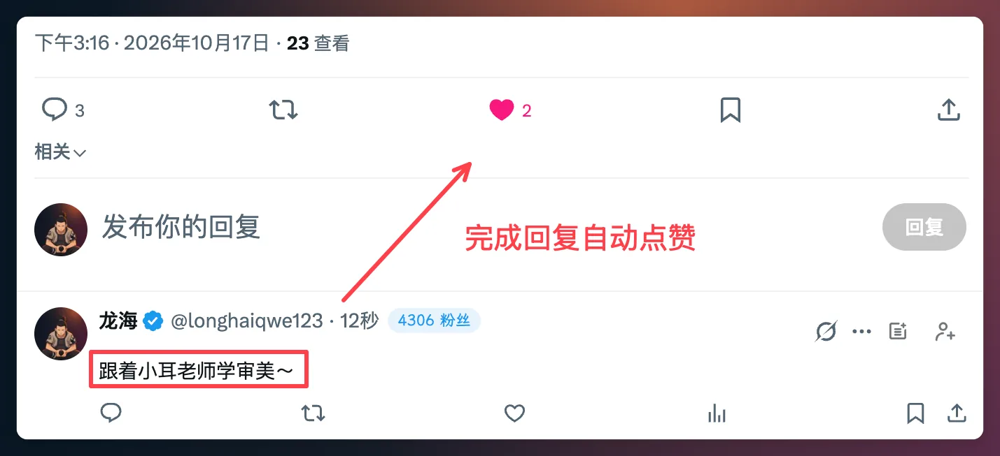
</p>

#### 媒体下载

在推文的分享菜单里加入下载图片、GIF 和视频（MP4）的选项，样式和菜单里的其他选项一致。你自己发的视频，X 菜单里已有「下载视频」，这时不再重复加入。

<p align="center">
  
</p>

#### 未互关标记

在你的「正在关注」列表里，把没有关注你的账号标红。

<p align="center">
  
</p>

#### X Lists

- 左侧导航栏加入「我的列表」入口，点击展开全部列表；位置可选「Home 上方」或「列表区」，切换后立即生效。
- 鼠标悬停在头像或用户名上时，资料卡里出现「+ List」按钮，点击后选择列表加入，不用进对方主页。
- 在设置里同步当前账号已有的 Lists，或通过链接、ID 手动添加。

<p align="center">
  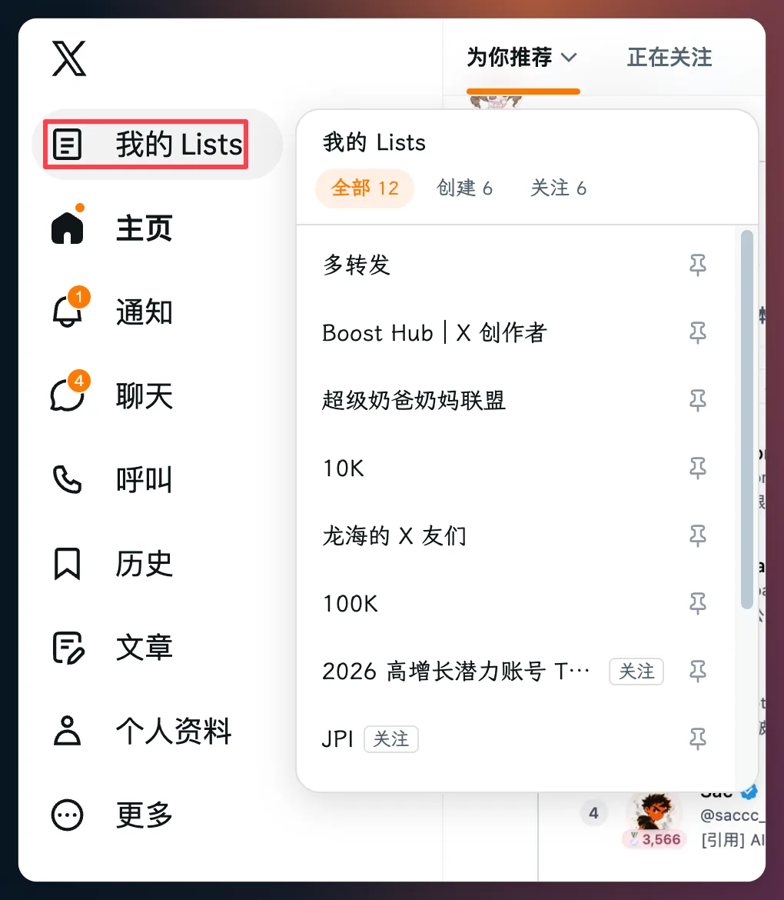
  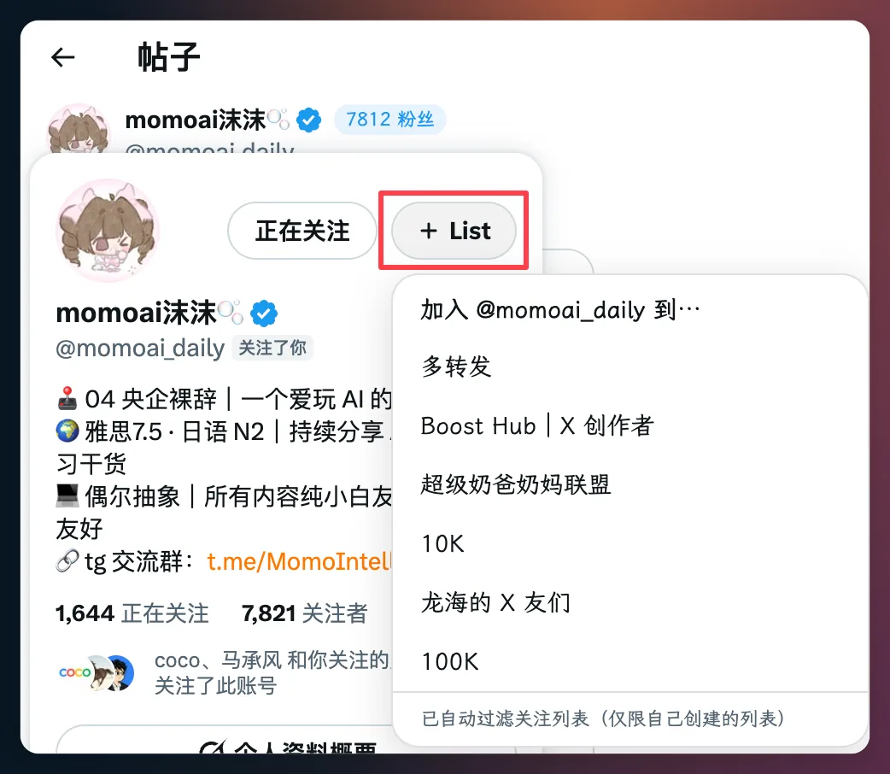<br>
  <sub>左：导航栏的「我的列表」；右：资料卡里的「+ List」</sub>
</p>

---

## 设置弹窗与完整设置页

点浏览器工具栏里的 oh-my-x 图标打开设置弹窗（400 像素宽），按 5 个模块分标签（模块归属定义在 `shared/feature-registry.ts`）：

| 标签（模块） | 功能 |
|------|------|
| **界面**（界面与阅读） | 时间线宽度、右侧边栏、发帖按钮、导航栏按钮与文字、长文目录、搜索默认「最新」、搜索筛选条、问 Grok、AI 转搜索语法 |
| **过滤**（内容过滤） | 垃圾回复过滤（今日拦截、隐藏阈值、调试模式、9 条检测规则、垃圾词库）、正文关键词过滤与屏蔽词、账号例外（白名单 / 黑名单）、拦截记录 |
| **数据**（数据洞察） | 看板：原创内容奖励计划、博主活动度；页面标注：爆款雷达、数据比例徽章、用户粉丝数、收藏量 |
| **创作**（创作与发布） | 引用我的帖子、多图排版与排序、按名字艾特、右键存草稿、AI 总结转发、排期全景 |
| **互动**（互动与列表） | 快捷键与底部悬浮条、直达回复区、回复自动点赞、媒体下载、未互关标记、X Lists |

「过滤」页分两层：第一层显示每个功能的开关和当前状态，点卡片右下角的「详细设置」「管理屏蔽词」「管理名单」「全部记录」进入第二层，左上角返回。

**界面语言**：弹窗顶部（完整设置页在侧栏顶部）的地球图标按钮可以选「跟随浏览器」「中文」「English」。跟随浏览器时，浏览器语言以 zh 开头用中文，其他用英文。X 页面上已经显示的插件界面，要刷新页面后才换语言。

**完整设置页**：点弹窗右上角的「完整设置」按钮，会在新标签页整页打开设置，并定位到弹窗当前所在的模块；也可以在 `chrome://extensions` 的扩展详情里点「扩展程序选项」打开。设置页和弹窗内容相同、设置共用，适合编辑词库、名单和 AI 服务配置。地址末尾的 `#layout`、`#filter`、`#insight`、`#create`、`#engage` 对应五个模块。

<p align="center">
  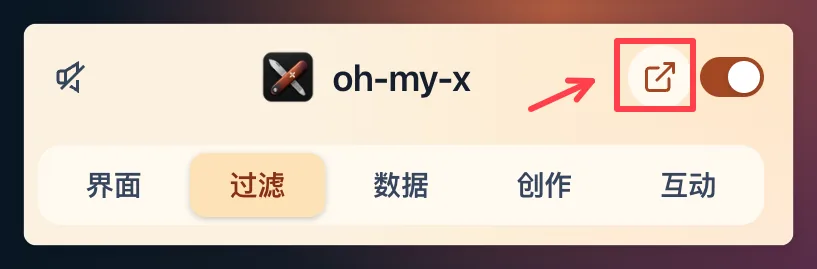
</p>
<p align="center">
  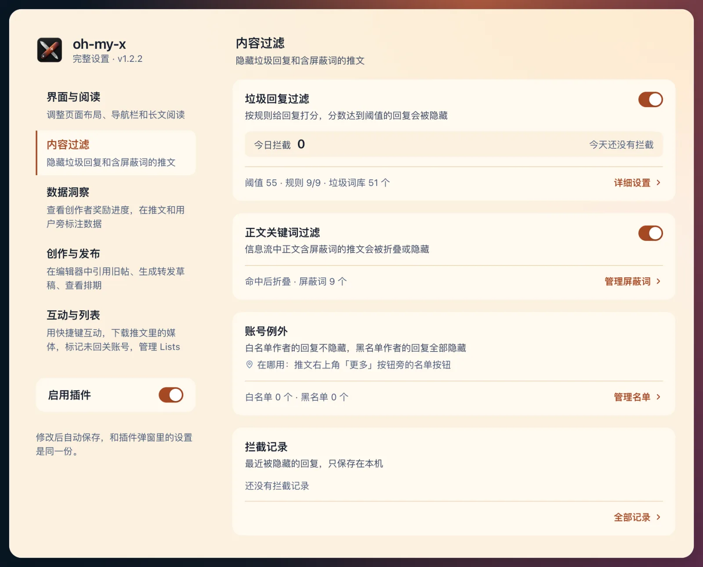
</p>

---

## 隐私

- **本地保存**：设置、关键词、拦截日志及 AI API Key 保存在 `browser.storage.local`，帖子库保存在扩展本地 IndexedDB。API Key 未由扩展加密，界面遮罩仅用于隐藏显示。
- **X 请求**：帖子同步、Lists、用户指标、创作者奖励和互动辅助会使用已有登录会话与 X 通信。开发者不接收这些数据，也不收集遥测。
- **可选 AI 请求**：只有用户主动生成或测试时，才向已授权的服务地址发送相应内容；该服务商的数据和计费条款适用。AI 请求不携带浏览器 Cookie。
- **权限**：使用 `storage`、`cookies`、`alarms`、`downloads`、`scripting`、`contextMenus`、`activeTab`（后两项用于右键存草稿：点菜单项后读一次当前网页选中的文字）；默认主机权限限于 X 相关域名和 `abs.twimg.com`。自定义 AI 主机通过可选权限按需授权，可在 Chrome 扩展设置中管理。
- **脚本运行范围**：仅在 `twitter.com`、`mobile.twitter.com`、`x.com`、`pro.x.com` 注入页面脚本。

详见 [隐私政策](PRIVACY.md)。

---

## 反馈与交流

- 遇到问题或有新需求，欢迎提 [Issue](https://github.com/longhaiqwe/oh-my-x/issues) 或 Pull Request，也欢迎基于源码自己改。
- X 用户群：[点此加入](https://x.com/i/chat/group_join/g2111364237507670445/ElRmy78U7D)，使用建议在这里反馈，和现有功能不冲突的会尽量实现。
- 作者：龙海 [@longhaiqwe123](https://x.com/longhaiqwe123)

## 致谢

- 星川（[@star_flow_ai](https://x.com/star_flow_ai)）的 [X Focus](https://x.com/star_flow_ai/status/2097583620936585339)：oh-my-x 在它的基础上开发。
- 在 X 上提出需求和建议的朋友们。

---

## 开发

```bash
npm install
npm run dev        # 开发模式（HMR）
npm run build      # 生产构建
npm test           # 运行单元、DOM 与集成测试
npm run typecheck  # 检查 TypeScript 与 Vue 脚本、模板
npm run check      # 类型检查 + 全量测试 + 生产构建
npm run zip        # 构建 + 打包 ZIP
npm run clean      # 清理构建产物
```

GitHub Actions 会在 push、pull request 和手动触发时执行 `npm ci` 与 `npm run check`，通过后保存 Chrome 扩展构建产物 7 天。

**发布新版本**：先把 `package.json` 的 `version` 改成新版本号并提交，再推送同名标签（如 `git tag v2.0.0 && git push origin v2.0.0`）。`release.yml` 会检查标签与版本号一致，跑完 `npm run check` 后把 `oh-my-x-chrome-mv3.zip` 发到 Releases 页面。CI 使用 Node.js 24；本地建议使用 Node.js 24.15 或更新的 24.x。

界面文案在 `shared/i18n/zh-CN.ts` 和 `shared/i18n/en.ts`，规则见 [AGENT.md](AGENT.md) 的「界面语言」一节。

### 技术栈

| 领域 | 选型 |
|------|------|
| 扩展框架 | WXT + Vite |
| UI | Vue 3 + reka-ui |
| 样式 | Tailwind CSS 4 |
| 类型 | TypeScript |
| 测试 | Vitest + jsdom |

### 项目结构

```
oh-my-x/
├── entrypoints/
│   ├── content.ts       # 注入 x.com 的内容脚本（isolated world）
│   ├── interceptor.content.ts # MAIN world 数据拦截器（排期接口拦截）
│   ├── background.ts    # Service Worker（默认词库同步、帖子库、Lists 与媒体请求、创作者奖励、AI 请求）
│   ├── popup/           # 设置弹窗（Vue 3 SPA，5 个模块标签）
│   └── options/         # 完整设置页（新标签页打开，复用弹窗的模块页）
├── content-scripts/     # DOM 操作和功能实现
│   ├── features/        # 页面功能（爆款雷达、长文目录、Lists、快捷互动、AI 转发等）
│   ├── spam/            # 垃圾评论扫描引擎与规则检测
│   ├── options/         # 各功能选项（时间线、导航、编辑器、数据比例等）
│   └── utilities/       # 工具函数与 Storage 封装
├── shared/              # 跨环境共享逻辑（功能清单、规则引擎、AI 提示词、界面文案、数据类型）
├── docs/images/         # README 插图
├── test/                # Vitest 测试套件（单元、集成与样本测试）
└── storage-keys.ts      # 全部 storage key + 默认值
```

---

## License

MIT
